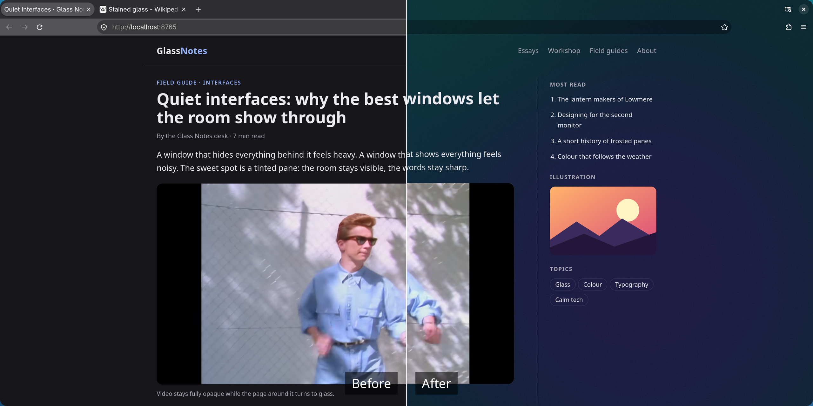
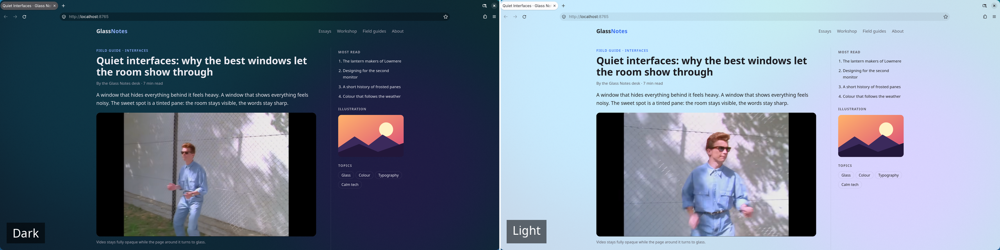
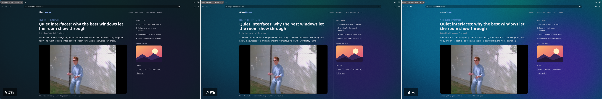
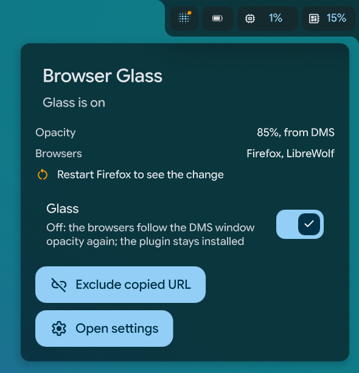
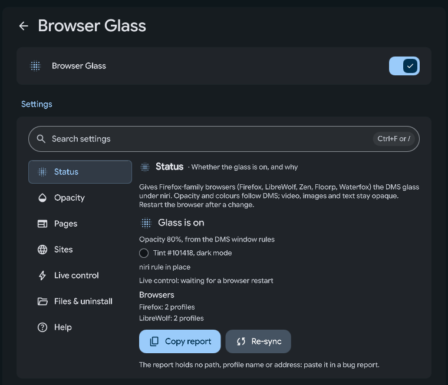
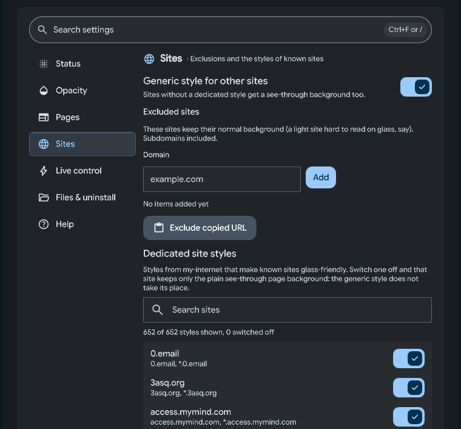

<div align="center">



*Left: without Browser Glass styling. Right: with Browser Glass.*

**Glass Firefox-family browsers for [DankMaterialShell](https://github.com/AvengeMedia/DankMaterialShell) on niri.**

Firefox, LibreWolf, Zen, Floorp and Waterfox take the DMS window opacity, blur and colours.
Page backgrounds turn see-through; video, images and text stay solid.

[Getting started](#getting-started) · [Usage](#usage) · [Launcher](#launcher) · [Settings](#settings) · [Troubleshooting](#troubleshooting) · [Roadmap](#roadmap) · [User guide](docs/GUIDE.md) · [Changelog](CHANGELOG.md)

</div>

## Getting started

### Requirements

| Dependency | Version | Needed for |
| --- | --- | --- |
| DankMaterialShell | 2.0.0 or newer | Everything |
| niri | Any recent version | The window rule that keeps video and text solid |
| A Firefox-family browser | Firefox, LibreWolf, Zen, Floorp or Waterfox; native, Flatpak or Snap. Tested live: native Firefox and LibreWolf; the others follow their documented layouts, and Snap Firefox needs one extra niri rule (see [Known limits](ROADMAP.md#known-limits)) | Everything |
| Python 3 | 3.9 or newer, standard library only | Everything (the plugin's helper script) |
| DMS blur | **Settings → Interface style → Background blur** on | The glass itself: with blur off, Browser Glass stays off |

The glass uses the opacity of your DMS window rules (**Settings → Applications → Window rules**, the first rule with no match that sets an opacity), or your own value from the plugin settings. At 100% there is nothing to see through, so Browser Glass stays off.

### 1. Install

Browser Glass is not in the DMS plugin registry, so it installs with git:

```sh
git clone https://github.com/lung595/browserGlass ~/.config/dms/plugins/browserGlass
```

Then click **Settings → Plugins → Manage Registries → *Scan*** if the plugin does not appear by itself.

<details>
<summary>Updating</summary>

```sh
git -C ~/.config/dms/plugins/browserGlass pull
dms restart
```

`dms restart` reloads the plugin's code; your settings are kept.
</details>

### 2. Enable

In **Settings → Plugins**, turn **Browser Glass** on. It sets up every browser profile it finds at once and shows *Browser Glass is set up: restart your browser to see the glass*.

### 3. Add the widget

The widget is optional: the glass works without it. It shows whether the glass is on, tells you when a browser needs a restart and gives you the glass switch.

**Settings → Bar widgets → Add**, then pick **Browser Glass**.

### 4. First steps

1. **Restart your browser.** Firefox reads its style files only when it starts. Until then the widget shows a dot, and its menu names the browser to restart.
2. Open a web page: the background is now the blurred, tinted desktop, and the page's pictures, video and text stay solid.
3. Open **Settings → Plugins → Browser Glass** to check the **Status** section and tune the look.

## Features


*Before (without Browser Glass styling) and after.*

- **The whole browser turns glass**: tabs, toolbars, sidebars and page backgrounds show the blurred desktop behind them, tinted with your DMS surface colour.
- **What you read stays solid.** niri keeps the browser window fully opaque, and only the backgrounds are see-through, so video, images and text do not fade.
- **Colours follow DMS.** The tint is the DMS surface colour of the current mode, and websites are asked for a light or dark scheme to match.

  

  *The tint follows DMS: change the wallpaper or the mode, then restart the browser.*

  

  *Dark and light mode.*

- **Opacity follows DMS**, or a value of your own just for the browsers.

  

  *90%, 70% and 50% opacity.*

- **About 650 dedicated site styles** from [my-internet](https://github.com/sameerasw/my-internet) make well-known sites glass-friendly, and a generic style covers the others. Each one can be switched off.
- **Per-site exclusions**: a site that is hard to read on glass keeps its normal background, subdomains included.

  

  *A glass site next to an excluded one.*

- **Dark pages and uniform bars** (with *Live control*): under a dark theme, light pages switch to their own dark theme when they have one, or turn dark with the bundled [Dark Reader](https://darkreader.org) engine, and their background becomes glass, and every navigation bar along a window edge (a header, a sidebar, a bottom bar, fixed or stuck there with a background of its own) gets the same look on every site, matching the browser's own toolbar; text left without contrast on the glass gets a readable colour.
- **Glass commands in the DMS launcher**: type `gs blist` to exclude the site you are on, `gs list` to see the excluded ones. With *Live control*, the page changes at once, without a browser restart (see [Launcher](#launcher)).
- **Reader view and PDF, the new tab page and private windows** each have a switch.
- **Knows when to restart**: Browser Glass sees which running browser has not loaded the latest change yet and names it.
- **Every Firefox-family browser and profile**: Firefox, LibreWolf, Zen, Floorp and Waterfox, native, Flatpak and Snap, all profiles at once. Tested live: native Firefox and LibreWolf; the others follow their documented layouts, and Snap Firefox needs one extra niri rule (see [Known limits](ROADMAP.md#known-limits)).
- **Leaves nothing behind.** Disabling the plugin restores `userChrome.css`, `userContent.css` and `user.js` byte for byte, even with the browsers open; the original preference values go back into `prefs.js` once each browser closes. A file you edited yourself keeps your edits.
- **No network.** Everything, site styles included, ships with the plugin.

## Usage

**The bar widget** shows a glass icon (crossed out while the glass is off) and a dot while a browser needs a restart. Click it for the menu:



| In the menu | What it does |
| --- | --- |
| Status lines | Whether the glass is on (or why not), the opacity and where it comes from, the browsers found |
| *Restart Firefox to see the change* | Shown while a running browser still has the old styles |
| **Glass** | Turns the glass off and on. Off, the browsers follow the DMS window opacity again; the plugin stays installed |
| **Exclude copied URL** | Copy a page's address in the browser (<kbd>Ctrl</kbd>+<kbd>L</kbd>, <kbd>Ctrl</kbd>+<kbd>C</kbd>), then click: that site keeps its normal background |
| **Open settings** | Opens the Browser Glass settings |


**Most changes need a browser restart.** Firefox only loads its style files when it starts. Changes in DMS (colours, blur, window opacity) and in the plugin settings are written at once; the widget then tells you which browser to restart. Two changes need none: switching DMS between light and dark (with *Sync with portal* on), and, with [Live control](#advanced--help), excluding a site or putting it back.

**Excluding a site.** The quickest way is the launcher: with the page in front, open the DMS launcher and type `gs blist` (see [Launcher](#launcher)). Or copy the address of the page in the browser, then use **Exclude copied URL** in the widget, in the settings or from a key binding (see [below](#command-line-and-keybindings)). The site and its subdomains keep their normal look, at once with Live control, otherwise after the next restart. Remove it with `gs unblist`, from `gs list`, or from **Settings → Sites → Excluded sites**.

## Launcher

<!-- launcher.gif, to record with tools/media/launcher_gif.sh:  -->

Open the DMS launcher and type `glass` or `gs`: the Browser Glass commands show up with the other results. `glass` or `gs` alone lists them all, and the start of a command is enough (`gs b` finds `blist`). In the plugin's own view of the launcher (its *Browse* entry, or the *Plugins* tab), the bare words work too (`on`, `list exa`), and an empty query lists the commands.

| Type | What it does |
| --- | --- |
| `gs on`, `gs off` | Turns the glass on or off for every browser, like the widget's **Glass** switch. The line shows whether the glass is on now |
| `gs blist` (or `gs fix`) | Excludes the site open in the browser in front, with all its subdomains: on `account.example.org`, it excludes `example.org`. The line shows *example.org — with its subdomains*, or *example.org is already excluded* |
| `gs unblist` | Puts that site back under glass: every exclusion that covers it is removed. The line names the exclusions that cover it, *example.org is excluded* (or *account.example.org is excluded* for an exclusion made with **Exclude copied URL**), or shows *example.org is not excluded*, and the toast names the exclusions removed |
| `gs list` | The excluded sites (the line says how many). Press <kbd>Enter</kbd> on one to remove it from the list, and the list opens again; `gs list exa` filters the list |

A short toast confirms each action: *Glass on*, *Glass off*, *Glass on, but not shown* (with the reason, for example when DMS blur is off), *example.org excluded*, *example.org back under glass*, *example.org is already excluded* or *example.org is not excluded*. When the site cannot be told, a warning says why and nothing is done: *No browser in the foreground*, *Private window: site not detected*, *Not a web page* (a `file:` or `about:` page), *Address not supported* (an IPv6 address, or a name such as `github.io` that holds other people's sites), *Current tab uncertain*, *Browser session unreadable*, *Restart the browser once more* (after a plugin update), or *Current site not found* (try again in a few seconds).

**At once, or at the next restart.** With **Live control** on (the default, see [Settings](#advanced--help)) and its companion add-on running in the browser, an exclusion applies to the open pages at once: the toast says *example.org excluded*. Otherwise the toast says *example.org excluded — applies after a restart* (or *example.org back under glass — applies after a restart*): the change is written, and the browser shows it after its next restart. That is the case on Firefox release builds, before the first browser restart after the add-on was installed, in Flatpak and Snap browsers and in private windows (see [Troubleshooting](#troubleshooting)). `gs on` and `gs off` always need a browser restart for the browser's own bars: the window itself follows at once.

**Which site.** The site is taken from the browser window in focus, or the one that was in focus just before the launcher opened; with several browsers open, it is that window's browser. The companion add-on reports the open tab's host; without it, Browser Glass reads the browser's saved session, which can be some seconds late (when it is more than 10 s old, the toast adds *from the session saved 25 s ago*). A private window is never read: `gs blist` refuses there.

The Browser Glass results come after the apps whose name matches, ten lines at most: with more than ten excluded sites, `gs list` shows nine and a line *N more: type gs list <filter>* (narrow it with `gs list exa`; the plugin's own view shows them all). Excluding with the launcher takes the whole site (`example.org`), while **Exclude copied URL** takes the host you copied (`account.example.org`, without a leading `www.`).

## Settings

Open **Settings → Plugins → Browser Glass**.

### Status



| Item | What it shows or does |
| --- | --- |
| Headline | *Glass is on*, or why it is off: *DMS blur is off*, *Window opacity is 100%*, *Glass is turned off* |
| Restart line | Which browser to restart to see the latest change |
| Opacity, tint, niri | The opacity in use and its source, the tint colour and mode, whether the niri rule is in place |
| Browsers | Each browser found and how many of its profiles are set up |
| Live control | Where [Live control](#advanced--help) stands (see below) |
| Warnings | Anything that was skipped, in plain words (a read-only file, a Zen transparency mod...) |
| **Turn glass on** | Shown when the glass was switched off |
| **Copy report** | Copies an anonymous report for a bug report (see [Privacy](#privacy)) |
| **Re-sync** | Writes everything again now |

### Appearance


| Setting | Default | What it does |
| --- | --- | --- |
| DMS window opacity | | Read only: the opacity of the first global DMS window rule |
| **Override** | Off | Use an opacity of your own for the browsers instead of the DMS one |
| **Browser opacity** | 85% | Shown with Override on. 20% to 100%; 100% turns the glass off |
| **Site theme** | Follow DMS | The light or dark scheme websites are asked for: *Follow DMS*, *Always dark* or *Leave as is* (your browser's own choice) |
| **Glass web pages** | On | Off: only the browser's own interface (tabs, address bar) is glass |
| **Glass new tab** | On | The new tab, home and private browsing pages |
| **Opaque reader view and PDF** | On | Keeps reader view and the PDF viewer solid, for reading |
| **Glass private windows** | On | Off: private windows keep a solid background |

### Sites



| Setting | Default | What it does |
| --- | --- | --- |
| **Generic style for other sites** | On | Adds see-through backgrounds to the inner parts of sites without a dedicated style (the page background is see-through either way) |
| **Dark pages** | On | Under a dark theme, the companion add-on switches light pages to their own dark theme when they have one, otherwise turns them dark with the bundled [Dark Reader](https://darkreader.org) engine, and their background becomes glass. Needs *Live control* |
| **Excluded sites** | Empty | These sites keep their normal background. Type a domain and press **Add**, or use **Exclude copied URL**. Subdomains included |
| **Dedicated site styles** | All on | The my-internet styles, searchable. Switch one off and that site loses its tailored style |

### Advanced & help

| Setting | Default | What it does |
| --- | --- | --- |
| **Live control** | On | Installs Browser Glass's small companion add-on in each browser profile, so that the launcher's glass commands apply at once instead of at the next browser restart. To load it, Browser Glass sets `xpinstall.signatures.required` to `false` and lets add-ons placed in the profile folder load without a prompt. Firefox release builds refuse unsigned add-ons: there, changes apply at the next restart. A signed add-on, which they accept, is planned for a later version. Uninstalling Browser Glass removes the add-on and puts these settings back |

The **Status** section has a line for it:

| Line | Meaning |
| --- | --- |
| *Live control: connected* | A browser runs the add-on, so the launcher's changes apply at once |
| *Live control: waiting for a browser restart* | The add-on is in place and loads at the next browser start. After a plugin update, it also shows while the browser still runs the older add-on |
| *Live control: not available for these browsers; changes apply at the next restart* | No profile could take the add-on: a Firefox release, ESR or Beta build (the add-on is not signed yet), only Flatpak and Snap browsers, or a browser that refused it (see [Troubleshooting](#troubleshooting)) |
| *Live control: the add-on was removed in the browser; turn Live control off and on to add it back* | The add-on was removed in about:addons, so Browser Glass leaves it out and puts the add-on settings back. Turn **Live control** off and on to install it again |
| *Live control: off* | The setting is off |

The [user guide](docs/GUIDE.md#live-control) explains how it works.

The section also has what the plugin writes, how to uninstall it by hand, notes on Zen and niri, and links to this page, the [user guide](docs/GUIDE.md) and the [issue tracker](https://github.com/lung595/browserGlass/issues).

## Command line and keybindings

```sh
dms ipc call browserGlass toggle            # glass off or on; answers "glass on" or "glass off"
dms ipc call browserGlass excludeClipboard  # exclude the site whose address is in the clipboard
dms ipc call browserGlass sync              # write everything again now
dms ipc call browserGlass status            # the last status (JSON) and ask for a fresh one
dms ipc call browserGlass report            # copy the anonymous report to the clipboard
dms ipc call browserGlass excludeCurrent    # exclude the site open in the browser in front, like gs blist
dms ipc call browserGlass includeCurrent    # put it back under glass, like gs unblist
dms ipc call browserGlass glass "unblist"   # any launcher command: on, off, blist, fix, unblist, list
```

The last three take the same path as the launcher and show the same toasts. They answer `OK`; `glass` answers `unknown command: ...` for a word it does not know. A short start of a command works when only one command has it (`glass "unb"`). `glass "list"` opens the launcher on `glass list`.

Bind them in niri, for example in `~/.config/niri/config.kdl`:

```kdl
binds {
    Mod+Shift+G { spawn "dms" "ipc" "call" "browserGlass" "toggle"; }
    Mod+Shift+X { spawn "dms" "ipc" "call" "browserGlass" "excludeCurrent"; }
}
```

The helper script also runs on its own, without DMS:

```sh
python3 -I ~/.config/dms/plugins/browserGlass/browserglass.py status --json  # the status
python3 -I ~/.config/dms/plugins/browserGlass/browserglass.py report         # the anonymous report
python3 -I ~/.config/dms/plugins/browserGlass/browserglass.py uninstall      # restore every browser (disable the plugin first)
```

`sync` takes the settings as `--settings JSON` or, as the plugin passes them so that the excluded sites stay out of the process list, `--settings-file FILE` (a file of yours, read then deleted).

`active-site --json --pid PID --app-id APP_ID [--window-id ID | --title TITLE]` answers which site a browser window shows, as the launcher asks it: the window's process id, app ID and id come from `niri msg --json windows`. With `--window-id`, the title is read from niri itself (`$NIRI_SOCKET`), so it never shows in the process list; the launcher passes only the id. An unreachable niri is an error (exit status 1); a window that is gone answers `no_browser`. It prints `{"host": ..., "domain": ..., "source": "companion" | "session", "age": ...}` (`age`: how many seconds old the saved session is, `null` for the companion), or `{"error": ...}`, both with exit status 0:

| Error | Meaning |
| --- | --- |
| `no_browser` | The window is not a Firefox-family browser |
| `private` | A private window: never read |
| `not_web` | Not an `http` or `https` page |
| `no_session` | No readable session for the browser's profile |
| `ambiguous` | The current tab cannot be told for sure |
| `unsupported` | An IPv6 address, an unusable host, or a host that is itself a public suffix (`github.io`) |
| `outdated` | The add-on and the helper are from different versions: restart the browser once more |

It only reads, and prints to your terminal only.

## Troubleshooting

<details>
<summary><b>Nothing changed in the browser</b></summary>

Restart the browser: Firefox reads its style files only at start-up. Close **every** window of it (check that no process is left with `pgrep -a firefox`), then open it again. The widget's dot goes away once all running browsers have the latest styles.
</details>

<details>
<summary><b>The launcher says <i>applies after a restart</i></b></summary>

The exclusion is saved, but no companion add-on could apply it at once, so the browser shows it after its next restart. The *Live control* line in **Settings → Plugins → Browser Glass → Status** tells you why:

- **Firefox release, ESR and Beta builds** refuse unsigned add-ons, and the companion is not signed yet: there, changes apply at the next restart. A signed add-on, which they accept, is planned for a later version.
- **You disabled the add-on** in `about:addons`: enable it again there.
- **The first restart.** The add-on is placed in the profile while the browser runs, and the browser loads it when it starts. Restart the browser once; *waiting for a browser restart* then turns into *connected*.
- **After a plugin update** the browser still runs the older add-on: the status says *waiting for a browser restart*, and `gs blist` answers *Restart the browser once more*. Restart it once.
- **Flatpak and Snap browsers** have no live control yet: the helper would run inside their sandbox.
- **Private windows** do not run the add-on, so the launcher cannot read their site.
- **You removed the add-on** in `about:addons`: Browser Glass does not put it back, even after a browser update, and takes its preferences back. To have it again, turn **Live control** off and on. On LibreWolf, Firefox Nightly and Developer Edition this always holds. On other browsers it holds once Browser Glass has seen the add-on loaded (it looks after each sync, and while it waits for a restart); a removal before that looks like the browser refusing the add-on, and the add-on comes back after the next browser update.
</details>

<details>
<summary><b>about:addons says the companion <i>could not be verified</i></b></summary>

LibreWolf shows this for every add-on that is not signed by Mozilla, and the Browser Glass companion is not signed yet (a signed add-on is planned for a later version). It is normal and harmless: the add-on is loaded and works. Turn **Live control** off if you would rather not have it; the next sync removes the add-on. Removing it in `about:addons` also works: Browser Glass then leaves it out, and takes its preferences back.
</details>

<details>
<summary><b>glass commands do not show in the launcher</b></summary>

The commands answer in the launcher's default *all* mode, when the first word you type is exactly `glass` or `gs`. Check that DMS's launcher setting that lets plugins answer without their trigger (`allowWithoutTrigger`, on by default) is still on: off, the Browser Glass commands disappear. After updating the plugin, run `dms restart` once, since DMS loads a new launcher file only at start-up. The results come after the apps whose name matches, ten lines at most.
</details>

<details>
<summary><b>The status says <i>DMS blur is off</i></b></summary>

Turn on **Settings → Interface style → Background blur**. Without blur, glass would just be a faded window, so Browser Glass stays off and the browsers keep their normal look.
</details>

<details>
<summary><b>The status says <i>Window opacity is 100%</i></b></summary>

Your DMS window rules give windows an opacity of 1 (or none at all). Set an opacity below 100% in **Settings → Applications → Window rules**, or turn on **Override** in the Browser Glass settings and pick a **Browser opacity**.
</details>

<details>
<summary><b>The opacity shown is not the one niri uses</b></summary>

Browser Glass reads the **first** global rule (a `window-rule` with no `match`) that sets an opacity in `~/.config/niri/dms/windowrules.kdl`, while niri applies the **last** one. Keep a single global opacity rule, or use **Override**.
</details>

<details>
<summary><b>Video and text are see-through too</b></summary>

The niri rule that keeps browser windows fully opaque is missing. Check the **niri** line in **Status**, and that `~/.config/niri/config.kdl` holds the line `include optional=true "dms-browser-glass.kdl"`, then click **Re-sync**. Your niri must be recent enough to read `include` lines (DMS 2 needs them too).

With the Snap Firefox, niri may see the window as `firefox_firefox`, which the rule does not cover yet (it could not be tested). Run `niri msg windows` to see the app ID, and if needed add your own rule at the end of `~/.config/niri/config.kdl` (after the DMS includes, since a later rule wins):

```kdl
window-rule {
    match app-id="^firefox_firefox$"
    opacity 1.0
}
```
</details>

<details>
<summary><b>Glass is off, but browsers ignore the DMS opacity</b></summary>

When the glass goes off while a browser still runs with the glass styles, Browser Glass keeps the niri rule (the window stays opaque) until that browser restarts, so it never shows a faded glass window. Restart the browser: the rule goes away by itself. A profile whose lock cannot be read counts as running, so it holds the rule too; closing that browser fixes it.
</details>

<details>
<summary><b>Zen is too see-through</b></summary>

Zen's own transparency mods (Zen Mods) stack with Browser Glass. When one is installed, the status shows *Zen transparency mod detected* and a toast tells you. Keep only one of the two: remove the mod in Zen's settings, or turn the glass off. Zen lists its mods in `zen-themes.json` in each profile folder. Zen support follows Zen's documented layout but has not been tested on a live Zen yet; reports are welcome.
</details>

<details>
<summary><b>Flatpak and Snap browsers</b></summary>

Browser Glass looks for profiles in the standard Flatpak folders (`~/.var/app/<app>/...`) and in the Snap Firefox folder (`~/snap/firefox/common/...`). A sandboxed browser whose profile lives elsewhere is not found. Only Firefox is known as a Snap. The XDG layouts of Floorp, Waterfox and the Snap could not be checked; if your profile is missing from **Status**, please open an issue with the report.
</details>

<details>
<summary><b>A warning in Status</b></summary>

Each warning names what was skipped: a read-only file or a broken link is left alone, an edited file keeps its backup, a profile that could not be read is skipped and the others still work. Fix the file, then click **Re-sync**. The [user guide](docs/GUIDE.md#warnings) lists them all.
</details>

<details>
<summary><b>Something else</b></summary>

Click **Copy report** in **Settings → Plugins → Browser Glass → Status** and paste it in a [new issue](https://github.com/lung595/browserGlass/issues). It holds no path, no profile name and no address.
</details>

## Privacy

- **No network access at all.** The site styles ship with the plugin; nothing is downloaded or sent, at install or at run time.
- **What is written, and where.** In each browser profile: `chrome/dms-glass-chrome.css`, `chrome/dms-glass-content.css`, one `@import` line in `userChrome.css` and in `userContent.css`, a marked block of up to three preferences in `user.js`, and the clean-up of those preferences in `prefs.js`. For niri: `~/.config/niri/dms-browser-glass.kdl` and one `include` line in `~/.config/niri/config.kdl`. For itself: a state file, a lock and the backups of the browser files in `~/.local/state/dms/browserGlass/` (`$XDG_STATE_HOME`). With **Live control**, also the companion add-on `extensions/browserglass@companion.xpi` and up to three more preferences in each profile, the helper's manifest `~/.mozilla/native-messaging-hosts/browserglass.json`, its launcher script `~/.local/state/dms/browserGlass/native-host`, and while a browser runs, a socket and two small files in `$XDG_RUNTIME_DIR/browserGlass/`. Its state folder also keeps `state-dirs.json` (the folders made for the state folder, with or without Live control) and `native-dirs.json` (the folders made for that manifest). Before each sync, the settings go in `$XDG_RUNTIME_DIR/browserGlass-sync-settings.json`, which the sync reads and deletes. Your DMS window rules and `~/.config/dms/firefox.css` are never touched. [More](docs/GUIDE.md#what-is-written-where)
- **Backups first.** The first time a browser file is changed, its original is saved. [More](docs/GUIDE.md#backups)
- **No timer at rest.** Browser Glass acts only when a setting, the DMS colours, the blur or the window rules change, and checks the browsers every 10 s only while one needs a restart. The launcher asks for the current site only when you type a glass command.
- **The companion add-on stays local.** With **Live control**, the add-on tells the Browser Glass helper the host of the active tab of the browser window in focus (`account.example.org`, never the full address or the page) and a short hash of its title, so the launcher can tell which site you mean. The helper is started by the browser, talks only to it and to Browser Glass on your machine, and keeps that host in a file under `$XDG_RUNTIME_DIR/browserGlass/` (memory, readable by you only), deleted when the browser closes. Nothing is written elsewhere, logged or sent. Private windows are never seen.
- **The anonymous report** holds versions, counts, settings and warning codes: no path, profile name, site or address. It is built only when you ask, goes to your clipboard, and is never sent anywhere.
- **Uninstalling leaves nothing.** Disabling the plugin restores `userChrome.css`, `userContent.css` and `user.js` byte for byte, even with the browsers open; the original preference values go back into `prefs.js` once each browser closes (a cleaner waits for it, for up to 7 days). It also removes the niri file and line, the companion add-on, its preferences and the helper's files, and the plugin's state. A file you edited yourself since its backup keeps your edits: only Browser Glass's lines are taken out, and the backup stays for you. Deleting the plugin folder while DMS runs starts the same clean-up on its own. [More](docs/GUIDE.md#uninstalling)

## Roadmap

These are plans, not promises, and they have no dates. The full list, what is not planned and the known limits are in [ROADMAP.md](ROADMAP.md).

**Next**

- The companion add-on signed by Mozilla, so *Live control* works on Firefox release, ESR and Beta builds.
- New screenshots for the launcher (a GIF) and the *Sites* settings.

**Later**

- *Live control* in Flatpak and Snap browsers.
- Live checks on Zen, Floorp and Waterfox, and Snap Firefox in the niri rule.
- An option to leave some profiles of a browser without glass.
- The DMS plugin registry, once the plugin has had wider use.

## Documentation

| File | Content |
| --- | --- |
| [docs/GUIDE.md](docs/GUIDE.md) | Full user guide: how it works, sites, restart detection, backups, uninstalling, FAQ |
| [CHANGELOG.md](CHANGELOG.md) | What changed in each version |
| [ROADMAP.md](ROADMAP.md) | Planned work, what is not planned, and the known limits |
| [CONTRIBUTING.md](CONTRIBUTING.md) | Architecture, tests and release process, for anyone working on the code |

## Credits

The dedicated site styles and the generic style come from [my-internet](https://github.com/sameerasw/my-internet) by sameerasw, under the MIT license ([data/MY-INTERNET-LICENSE](data/MY-INTERNET-LICENSE)); Browser Glass keeps only their transparency features. The companion add-on bundles the [Dark Reader](https://github.com/darkreader/darkreader) engine (v4.9.135, from its npm package, unmodified) by Dark Reader Ltd., under the MIT license ([extension/vendor/darkreader-LICENSE.txt](extension/vendor/darkreader-LICENSE.txt)). The bundled [Public Suffix List](https://publicsuffix.org) is Mozilla's, under the MPL-2.0 ([data/PSL-LICENSE](data/PSL-LICENSE)), with some whole lines removed. Built on [DankMaterialShell](https://github.com/AvengeMedia/DankMaterialShell), [Quickshell](https://quickshell.org) and [niri](https://github.com/YaLTeR/niri).

## License

[MIT](LICENSE) © lung595
