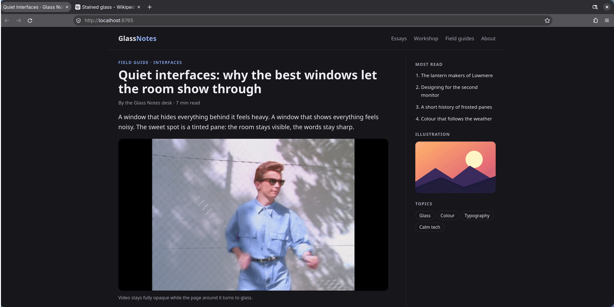
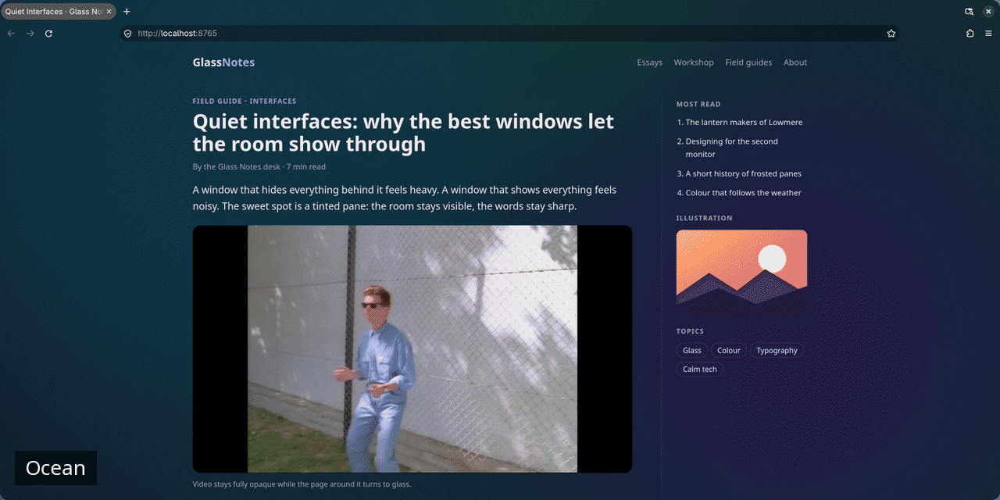
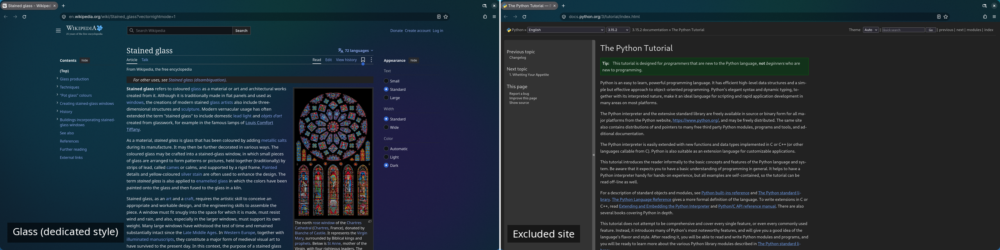
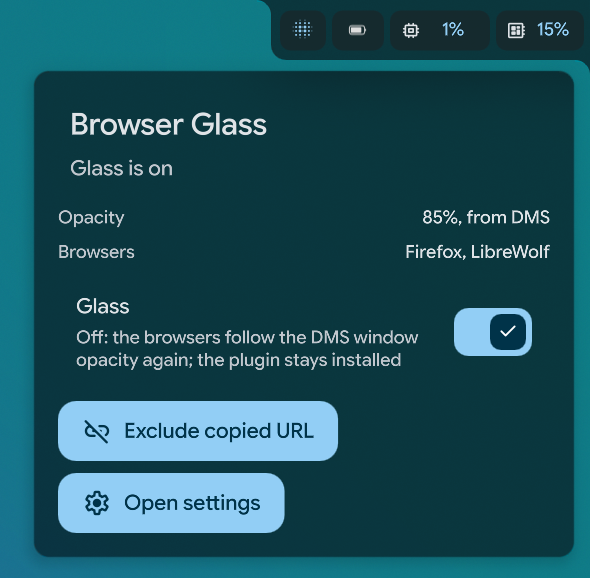
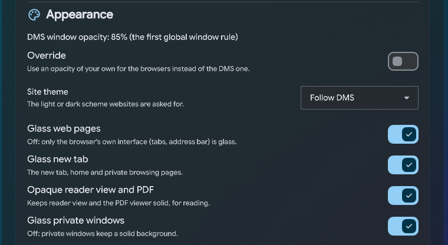

<div align="center">


*Left: without Browser Glass styling. Right: with Browser Glass.*

**Glass Firefox-family browsers for [DankMaterialShell](https://github.com/AvengeMedia/DankMaterialShell) on niri.**

Firefox, LibreWolf, Zen, Floorp and Waterfox take the DMS window opacity, blur and colours.
Page backgrounds turn see-through; video, images and text stay solid.

[Getting started](#getting-started) · [Usage](#usage) · [Settings](#settings) · [Troubleshooting](#troubleshooting) · [User guide](docs/GUIDE.md) · [Changelog](CHANGELOG.md)

</div>

## Getting started

### Requirements

| Dependency | Version | Needed for |
| --- | --- | --- |
| DankMaterialShell | 2.0.0 or newer | Everything |
| niri | Any recent version | The window rule that keeps video and text solid |
| A Firefox-family browser | Firefox, LibreWolf, Zen, Floorp or Waterfox; native, Flatpak or Snap. Tested live: native Firefox and LibreWolf; the others follow their documented layouts, and Snap Firefox needs one extra niri rule (see [Known limits](ROADMAP.md#known-limits)) | Everything |
| Python 3 | 3.9 or newer, standard library only | Everything (the plugin's helper script) |
| DMS blur | **Settings → Interface style → Background blur** on | The glass itself: with blur off, Browser Glass stays off |

The glass uses the opacity of your DMS window rules (**Settings → Applications → Window rules**, the first rule with no match that sets an opacity), or your own value from the plugin settings. At 100% there is nothing to see through, so Browser Glass stays off.

### 1. Install

Browser Glass is not in the DMS plugin registry, so it installs with git:

```sh
git clone https://github.com/lung595/browserGlass ~/.config/dms/plugins/browserGlass
```

Then click **Settings → Plugins → Manage Registries → *Scan*** if the plugin does not appear by itself.

<details>
<summary>Updating</summary>

```sh
git -C ~/.config/dms/plugins/browserGlass pull
dms restart
```

`dms restart` reloads the plugin's code; your settings are kept.
</details>

### 2. Enable

In **Settings → Plugins**, turn **Browser Glass** on. It sets up every browser profile it finds at once and shows *Browser Glass is set up: restart your browser to see the glass*.

### 3. Add the widget

The widget is optional: the glass works without it. It shows whether the glass is on, tells you when a browser needs a restart and gives you the glass switch.

**Settings → Bar widgets → Add**, then pick **Browser Glass**.

### 4. First steps

1. **Restart your browser.** Firefox reads its style files only when it starts. Until then the widget shows a dot, and its menu names the browser to restart.
2. Open a web page: the background is now the blurred, tinted desktop, and the page's pictures, video and text stay solid.
3. Open **Settings → Plugins → Browser Glass** to check the **Status** section and tune the look.

## Features



*Before (without Browser Glass styling) and after.*

- **The whole browser turns glass**: tabs, toolbars, sidebars and page backgrounds show the blurred desktop behind them, tinted with your DMS surface colour.
- **What you read stays solid.** niri keeps the browser window fully opaque, and only the backgrounds are see-through, so video, images and text do not fade.
- **Colours follow DMS.** The tint is the DMS surface colour of the current mode, and websites are asked for a light or dark scheme to match.

  

  *The tint follows DMS: change the wallpaper or the mode, then restart the browser.*

  

  *Dark and light mode.*

- **Opacity follows DMS**, or a value of your own just for the browsers.

  

  *90%, 70% and 50% opacity.*

- **About 650 dedicated site styles** from [my-internet](https://github.com/sameerasw/my-internet) make well-known sites glass-friendly, and a generic style covers the others. Each one can be switched off.
- **Per-site exclusions**: a site that is hard to read on glass keeps its normal background, subdomains included.

  

  *A glass site next to an excluded one.*

- **Reader view and PDF, the new tab page and private windows** each have a switch.
- **Knows when to restart**: Browser Glass sees which running browser has not loaded the latest change yet and names it.
- **Every Firefox-family browser and profile**: Firefox, LibreWolf, Zen, Floorp and Waterfox, native, Flatpak and Snap, all profiles at once. Tested live: native Firefox and LibreWolf; the others follow their documented layouts, and Snap Firefox needs one extra niri rule (see [Known limits](ROADMAP.md#known-limits)).
- **Leaves nothing behind.** Disabling the plugin restores `userChrome.css`, `userContent.css` and `user.js` byte for byte, even with the browsers open; the original preference values go back into `prefs.js` once each browser closes. A file you edited yourself keeps your edits.
- **No network.** Everything, site styles included, ships with the plugin.

## Usage

**The bar widget** shows a glass icon (crossed out while the glass is off) and a dot while a browser needs a restart. Click it for the menu:


| In the menu | What it does |
| --- | --- |
| Status lines | Whether the glass is on (or why not), the opacity and where it comes from, the browsers found |
| *Restart Firefox to see the change* | Shown while a running browser still has the old styles |
| **Glass** | Turns the glass off and on. Off, the browsers follow the DMS window opacity again; the plugin stays installed |
| **Exclude copied URL** | Copy a page's address in the browser (<kbd>Ctrl</kbd>+<kbd>L</kbd>, <kbd>Ctrl</kbd>+<kbd>C</kbd>), then click: that site keeps its normal background |
| **Open settings** | Opens the Browser Glass settings |



**Any change needs a browser restart.** Firefox only loads its style files when it starts. Changes in DMS (colours, light or dark mode, blur, window opacity) and in the plugin settings are written at once; the widget then tells you which browser to restart.

**Excluding a site.** In the browser, copy the address of the page, then use **Exclude copied URL** in the widget, in the settings or from a key binding (see [below](#command-line-and-keybindings)). The site and its subdomains keep their normal look after the next restart. Remove it from **Settings → Sites → Excluded sites**.

## Settings

Open **Settings → Plugins → Browser Glass**.

### Status


| Item | What it shows or does |
| --- | --- |
| Headline | *Glass is on*, or why it is off: *DMS blur is off*, *Window opacity is 100%*, *Glass is turned off* |
| Restart line | Which browser to restart to see the latest change |
| Opacity, tint, niri | The opacity in use and its source, the tint colour and mode, whether the niri rule is in place |
| Browsers | Each browser found and how many of its profiles are set up |
| Warnings | Anything that was skipped, in plain words (a read-only file, a Zen transparency mod...) |
| **Turn glass on** | Shown when the glass was switched off |
| **Copy report** | Copies an anonymous report for a bug report (see [Privacy](#privacy)) |
| **Re-sync** | Writes everything again now |

### Appearance



| Setting | Default | What it does |
| --- | --- | --- |
| DMS window opacity | | Read only: the opacity of the first global DMS window rule |
| **Override** | Off | Use an opacity of your own for the browsers instead of the DMS one |
| **Browser opacity** | 85% | Shown with Override on. 20% to 100%; 100% turns the glass off |
| **Site theme** | Follow DMS | The light or dark scheme websites are asked for: *Follow DMS*, *Always dark* or *Leave as is* (your browser's own choice) |
| **Glass web pages** | On | Off: only the browser's own interface (tabs, address bar) is glass |
| **Glass new tab** | On | The new tab, home and private browsing pages |
| **Opaque reader view and PDF** | On | Keeps reader view and the PDF viewer solid, for reading |
| **Glass private windows** | On | Off: private windows keep a solid background |

### Sites


| Setting | Default | What it does |
| --- | --- | --- |
| **Generic style for other sites** | On | Adds see-through backgrounds to the inner parts of sites without a dedicated style (the page background is see-through either way) |
| **Excluded sites** | Empty | These sites keep their normal background. Type a domain and press **Add**, or use **Exclude copied URL**. Subdomains included |
| **Dedicated site styles** | All on | The my-internet styles, searchable. Switch one off and that site loses its tailored style |

### Advanced & help

What the plugin writes, how to uninstall it by hand, notes on Zen and niri, and links to this page, the [user guide](docs/GUIDE.md) and the [issue tracker](https://github.com/lung595/browserGlass/issues).

## Command line and keybindings

```sh
dms ipc call browserGlass toggle            # glass off or on; answers "glass on" or "glass off"
dms ipc call browserGlass excludeClipboard  # exclude the site whose address is in the clipboard
dms ipc call browserGlass sync              # write everything again now
dms ipc call browserGlass status            # the last status (JSON) and ask for a fresh one
dms ipc call browserGlass report            # copy the anonymous report to the clipboard
```

Bind them in niri, for example in `~/.config/niri/config.kdl`:

```kdl
binds {
    Mod+Shift+G { spawn "dms" "ipc" "call" "browserGlass" "toggle"; }
    Mod+Shift+X { spawn "dms" "ipc" "call" "browserGlass" "excludeClipboard"; }
}
```

The helper script also runs on its own, without DMS:

```sh
python3 -I ~/.config/dms/plugins/browserGlass/browserglass.py status --json  # the status
python3 -I ~/.config/dms/plugins/browserGlass/browserglass.py report         # the anonymous report
python3 -I ~/.config/dms/plugins/browserGlass/browserglass.py uninstall      # restore every browser (disable the plugin first)
```

## Troubleshooting

<details>
<summary><b>Nothing changed in the browser</b></summary>

Restart the browser: Firefox reads its style files only at start-up. Close **every** window of it (check that no process is left with `pgrep -a firefox`), then open it again. The widget's dot goes away once all running browsers have the latest styles.
</details>

<details>
<summary><b>The status says <i>DMS blur is off</i></b></summary>

Turn on **Settings → Interface style → Background blur**. Without blur, glass would just be a faded window, so Browser Glass stays off and the browsers keep their normal look.
</details>

<details>
<summary><b>The status says <i>Window opacity is 100%</i></b></summary>

Your DMS window rules give windows an opacity of 1 (or none at all). Set an opacity below 100% in **Settings → Applications → Window rules**, or turn on **Override** in the Browser Glass settings and pick a **Browser opacity**.
</details>

<details>
<summary><b>The opacity shown is not the one niri uses</b></summary>

Browser Glass reads the **first** global rule (a `window-rule` with no `match`) that sets an opacity in `~/.config/niri/dms/windowrules.kdl`, while niri applies the **last** one. Keep a single global opacity rule, or use **Override**.
</details>

<details>
<summary><b>Video and text are see-through too</b></summary>

The niri rule that keeps browser windows fully opaque is missing. Check the **niri** line in **Status**, and that `~/.config/niri/config.kdl` holds the line `include optional=true "dms-browser-glass.kdl"`, then click **Re-sync**. Your niri must be recent enough to read `include` lines (DMS 2 needs them too).

With the Snap Firefox, niri may see the window as `firefox_firefox`, which the rule does not cover yet (it could not be tested). Run `niri msg windows` to see the app ID, and if needed add your own rule at the end of `~/.config/niri/config.kdl` (after the DMS includes, since a later rule wins):

```kdl
window-rule {
    match app-id="^firefox_firefox$"
    opacity 1.0
}
```
</details>

<details>
<summary><b>Glass is off, but browsers ignore the DMS opacity</b></summary>

When the glass goes off while a browser still runs with the glass styles, Browser Glass keeps the niri rule (the window stays opaque) until that browser restarts, so it never shows a faded glass window. Restart the browser: the rule goes away by itself. A profile whose lock cannot be read counts as running, so it holds the rule too; closing that browser fixes it.
</details>

<details>
<summary><b>Zen is too see-through</b></summary>

Zen's own transparency mods (Zen Mods) stack with Browser Glass. When one is installed, the status shows *Zen transparency mod detected* and a toast tells you. Keep only one of the two: remove the mod in Zen's settings, or turn the glass off. Zen lists its mods in `zen-themes.json` in each profile folder. Zen support follows Zen's documented layout but has not been tested on a live Zen yet; reports are welcome.
</details>

<details>
<summary><b>Flatpak and Snap browsers</b></summary>

Browser Glass looks for profiles in the standard Flatpak folders (`~/.var/app/<app>/...`) and in the Snap Firefox folder (`~/snap/firefox/common/...`). A sandboxed browser whose profile lives elsewhere is not found. Only Firefox is known as a Snap. The XDG layouts of Floorp, Waterfox and the Snap could not be checked; if your profile is missing from **Status**, please open an issue with the report.
</details>

<details>
<summary><b>A warning in Status</b></summary>

Each warning names what was skipped: a read-only file or a broken link is left alone, an edited file keeps its backup, a profile that could not be read is skipped and the others still work. Fix the file, then click **Re-sync**. The [user guide](docs/GUIDE.md#warnings) lists them all.
</details>

<details>
<summary><b>Something else</b></summary>

Click **Copy report** in **Settings → Plugins → Browser Glass → Status** and paste it in a [new issue](https://github.com/lung595/browserGlass/issues). It holds no path, no profile name and no address.
</details>

## Privacy

- **No network access at all.** The site styles ship with the plugin; nothing is downloaded or sent, at install or at run time.
- **What is written, and where.** In each browser profile: `chrome/dms-glass-chrome.css`, `chrome/dms-glass-content.css`, one `@import` line in `userChrome.css` and in `userContent.css`, a marked block of up to three preferences in `user.js`, and the clean-up of those preferences in `prefs.js`. For niri: `~/.config/niri/dms-browser-glass.kdl` and one `include` line in `~/.config/niri/config.kdl`. For itself: a state file, a lock and the backups of the browser files in `~/.local/state/dms/browserGlass/` (`$XDG_STATE_HOME`). Your DMS window rules and `~/.config/dms/firefox.css` are never touched. [More](docs/GUIDE.md#what-is-written-where)
- **Backups first.** The first time a browser file is changed, its original is saved. [More](docs/GUIDE.md#backups)
- **No timer at rest.** Browser Glass acts only when a setting, the DMS colours, the blur or the window rules change, and checks the browsers every 10 s only while one needs a restart.
- **The anonymous report** holds versions, counts, settings and warning codes: no path, profile name, site or address. It is built only when you ask, goes to your clipboard, and is never sent anywhere.
- **Uninstalling leaves nothing.** Disabling the plugin restores `userChrome.css`, `userContent.css` and `user.js` byte for byte, even with the browsers open; the original preference values go back into `prefs.js` once each browser closes (a cleaner waits for it, for up to 7 days). It also removes the niri file and line and the plugin's state. A file you edited yourself since its backup keeps your edits: only Browser Glass's lines are taken out, and the backup stays for you. Deleting the plugin folder while DMS runs starts the same clean-up on its own. [More](docs/GUIDE.md#uninstalling)

## Documentation

| File | Content |
| --- | --- |
| [docs/GUIDE.md](docs/GUIDE.md) | Full user guide: how it works, sites, restart detection, backups, uninstalling, FAQ |
| [CHANGELOG.md](CHANGELOG.md) | What changed in each version |
| [ROADMAP.md](ROADMAP.md) | Ideas for the future |
| [CONTRIBUTING.md](CONTRIBUTING.md) | Architecture, tests and release process, for anyone working on the code |

## Credits

The dedicated site styles and the generic style come from [my-internet](https://github.com/sameerasw/my-internet) by sameerasw, under the MIT license ([data/MY-INTERNET-LICENSE](data/MY-INTERNET-LICENSE)); Browser Glass keeps only their transparency features. Built on [DankMaterialShell](https://github.com/AvengeMedia/DankMaterialShell), [Quickshell](https://quickshell.org) and [niri](https://github.com/YaLTeR/niri).

## License

[MIT](LICENSE) © lung595
